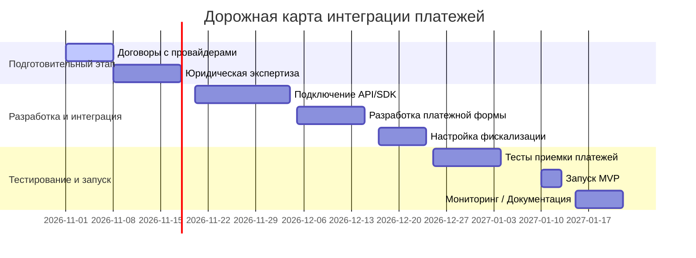

# Резюме  
Для MVP P2P-шеринга с платежами рассмотрено **8** решений: коммерческие агрегаторы и банки (ЮKassa/ЮMoney, QIWI, CloudPayments, Тинькофф Банк (Bank 131), Сбер (СБП, SberPay/VK Pay)) и примеры Open Source (Serenity, VeriTrust). Каждое решение проанализировано по техническим, юридическим и ценовым параметрам, а также приведён план интеграции и дорожная карта. Основные выводы:  

- **Технически** все провайдеры предлагают REST-API/SDK для приёма платежей картами, электронными кошельками и через Систему быстрых платежей (СБП). Многие поддерживают платёжные виджеты и мобильные SDK (iOS/Android). ЮKassa и CloudPayments умеют автоматически «сплитовать» один платёж между несколькими получателями, что важно для маркетплейса. Провайдеры сертифицированы по PCI DSS (например, CloudPayments – уровень 1) и обеспечивают TLS/шифрование. Поддерживаемые схемы: банковские карты (Visa/Mastercard/MIR), кошельки (ЮMoney, QIWI), СБП (перевод по номеру), SberPay, MIR Pay и др. Функционал включает авторизацию/холд платежей, рекуррент, возвраты, выдачу чеков (54-ФЗ), KYC/AML. Эскроу-логика может быть организована через держание средств на «холд»-счёте платформы. Масштабируемость платёжных API – от десятков тысяч до миллионов транзакций в день.  

- **Юридически** провайдеры имеют лицензии ЦБ (НКО или банки). Например, ЮMoney (ЮKassa) – лицензия №3510-К. Использование услуг подпадает под Законы 161-ФЗ (платежи), 115-ФЗ (ПОД/ФТ), 152-ФЗ (персональные данные), 54-ФЗ (онлайн-касса). Договоры заключаются по модели эквайринга или агрегатора: провайдер выступает расчётным агентом перед продавцами и платформой. Хранение и передача данных о клиентах (FZ-152) и защита платёжной информации (PCI DSS) обеспечивает провайдер. Ответственность за достоверность вводимых данных лежит на пользователях и платформе, провайдер в основном отвечает за техническую безопасность.  
  
- **Стоимость:** Комиссии варьируются: ЮKassa – от ~2.8% (0.5–3%) от суммы покупки; QIWI – ~2–4% (уточняется по согласованию); CloudPayments – от ~1.5–3% (зависит от оборота, точные ставки по договору); Тинькофф – ~1.8–2.5% (рублёвые карты); СБП – фиксированно 1–6 ₽ за перевод; VK Pay – около 1%. Подключение обычно бесплатно. Интеграционные расходы – разработка API, тесты; ежемесячных фиксированных платежей у большинства нет (кроме оценки банковских гарантий). 
  
Ниже даны сравнительные таблицы и схемы архитектуры/роадмапа для интеграции каждого решения.

## Обзор решений для P2P-платформы 

### ЮKassa (Яндекс.Платёж)  
ЮKassa — продукт ООО НКО «ЮМани» (лицензия ЦБ №3510-К). Специализируется на маркетплейсах: объединяет оплату покупателя и **сплитует платёж** между продавцами. Технически предоставляет REST API и готовый виджет/платёжную форму для сайта/мобильного приложения. Есть мобильные SDK. Поддерживает карты (Visa/Mastercard/MIR), ЮMoney-кошельки, СБП, ApplePay/GooglePay, др. Позволяет проводить **hold/авторизацию** средств до подтверждения заказа, рекуррентные платежи и возвраты. При использовании API платёжного конструктора кредитные данные шифруются в браузере, снижая требования PCI DSS (об этом у CloudPayments).  
Для маркетплейса ЮKassa обеспечивает: прямые расчёты между покупателем и продавцом без прохода средств через счёт платформы; гибкую настройку комиссии платформы. Например: «комиссия продавца — от 2.8%» (подключение бесплатное). Требуемый ежемесячный оборот – от 3 млн ₽. С юридической точки это эквайринг-провайдер с моделью split, обязанности по фискализации (54-ФЗ) и KYC ложатся на сторонние кассы и идентификацию пользователей. Выгрузка чеков, интеграция с ОФД – поддерживаются по API.  
**Ключевые параметры:** API (HTTPS/JSON), SDK мобильные, протоколы 3DS/ASV, хранение данных – Россия, PCI DSS – на стороне YooKassa, KYC по ФЗ-115 выполняется агрегацией чеков, комиссии 2.8%+, мультивалютность – рубли (есть опция USD/EUR).

### QIWI (АО «НКО КИВИ Платежная система»)  
QIWI – НКО, владеющее платёжной инфраструктурой и электронными кошельками. Предлагает API приёма платежей (QIWI Касса) и API операций с кошельком (BillPayments/Top-Up). Через BillPayments выставляются счета (QR, ссылки) и принимаются платежи картами и кошельками. Через Top-Up можно **переводить деньги на QIWI-кошельки** клиентов (запрос `pay`), т.е. выполнять P2P-перевод внутри сервиса QIWI. Есть SDK и библиотеки на разных языках. Поддерживается аутентификация token/key. Комиссии зависят от оборота и способа (примерно 2–4%+ фикс. комиссия). Проводятся авторизации, рекуррентные платежи и возвраты. С точки зрения регулятора QIWI – платёжная система с лицензией ЦБ для выпуска электронных денег; соблюдает 115-ФЗ и 152-ФЗ. Хранение пользовательских данных в России.  
**Особенности:** поддерживает переводы по номеру телефона/кошельку (аналог СБП внутри QIWI), мультивалютность – только RUB, 3DS-secure для карт. Использование Top-Up API позволяет напрямую переводить средства на кошельки пользователей (т.н. «пополнение счета пользователя»). При этом KYC пользователей обязан обеспечить провайдер (регистрация кошельков, верификация).

### CloudPayments (T‑Soft)  
CloudPayments – сервис эквайринга от компании Cloud (входит в экосистему Т‑Банк/Тинькофф). Предлагает **“облачную” платёжную платформу**: виджет, скрипт Checkout, REST API, мобильные SDK, вебхуки. Поддерживает карты (в т.ч. MIR, ApplePay, GooglePay), СБП, SberPay, MIR Pay, рекуррент, «безопасную сделку» (эскроу) и прочее. В документации отмечено, что **CloudPayments сертифицирован по PCI DSS (уровень 1)** и все платежи шифруются на клиенте. Merchant-сервер получает только «криптограмму» карт, что снимает с него требования PCI DSS. Сервис рассчитан на крупный объём (обрабатывает миллионы транзакций). Есть поддержка split-платежей через **Мультирасчёты**.  
Комиссии – договорные (зависит от оборотов; заявлены ~1.5–3% для карт). Подключение интеграционное, без абонентской платы (настройка через ЛК). Юридически CloudPayments – расчётный агент (лицензия Т‑Банка), счётчики чеков для 54-ФЗ (CloudKassir), хранение данных – в РФ. Из особенностей: встроенный фискальный модуль, поддержка токенизации карт (Checkout API).  
**Пример API:** CloudPayments API (api.cloudpayments.ru) позволяет «выполнить платёж, отмену, возврат, завершить двухстадийный платёж, создать/отменить подписку, отправить счёт по email». Имеется мобильный SDK для iOS/Android с клиентским шифрованием данных.

### Тинькофф Банк (Банк «131»)  
Тинькофф Банк (АО «Банк 131») предлагает собственные платёжные решения для бизнеса. Через его платёжную платформу можно принимать **карточные платежи** по REST API (интернет‑эквайринг, веб-виджеты, одноступенчатые/двухступенчатые операции, рекуррент, списание с токенизированных карт) и **безкарточные оплаты**. В портфеле – сервисы *T-Pay* (покупатель платит через вход в приложение Тинькофф), *SberPay* (оплата через Сбербанк ID), *ЮMoney* (платежи с ЮMoney-кошелька) и *СБП* (быстрые переводы по номеру телефона). Например, API «Платежи через ЮMoney» (Bank 131) поддерживает одноразовые и рекуррентные платежи с кошелька.  
Комиссии банка примерно 1.8–2.5% от суммы, тарифы индивидуальны. Схема – обычный эквайринг: Банк 131 принимает деньги, переводит на счёт продавца. Поскольку Тинькофф – банк, он имеет все необходимые лицензии (общая лицензия банковской деятельности №3538). Проведение платежей через сторонние банки (СБП, Сбер) реализуется через соответствующие шлюзы. Юридические требования те же: KYC по 115-ФЗ, подача чеков 54-ФЗ (банк может автоматически отправлять данные в ОФД), FZ-152.  

### Система быстрых платежей (СБП, ЦБ РФ)  
СБП – инфраструктура Банка России для мгновенных переводов по телефону. Практически все провайдеры (ЮKassa, CloudPayments, банки) интегрировали её. **Тарифы Банка России по СБП – от 1 до 6 руб.** в зависимости от суммы, в 2019–2020 гг. за обслуживание банковская комиссия отсутствовала. Технически это перевод со счёта на счёт (RUB), без 3DS, мгновенно. Платить можно из любого банка-участника по номеру телефона получателя. Интеграция осуществляется через API банковской или агрегаторской системы; для офомленнных пользователей KYC/AML уже пройдены банком. Валюта – только RUB. Считается «ровной» комиссии (не процент). СБП удобно для P2P-переводов: в сравнении с картой комиссия минимальна, платёж идёт без блокировок денег.  

### VK Pay и другие способы  
VK Pay – электронный кошелёк «Сбер-ВКонтакте»; позволяет пользователю платить друзьям/магазинам в сети. Комиссия низкая (~1%), поддерживает переводы по номеру телефона. Технически – ещё один кошелёк в экосистеме Сбербанка. Не требует отдельной лицензии (работает через эквайринг Сбера). **MIR Pay** – оплата в один клик через приложение на Android (сохраняет карты Мир). Поддерживается CloudPayments. Для MVP можно учитывать эти методы как опцию «дополнительный способ оплаты» (увеличивает конверсию), но основной фокус – на банальных карт и кошельков с минимальным порогом входа.  

### Open Source: Serenity и VeriTrust  
Для примера архитектуры и подходов можно обратить внимание на **открытые решения**. Проект *Serenity* (GitHub) – платформа маркетплейса (на NestJS), вдохновлённая Profi.ru и YouDo. Проект *VeriTrust* – P2P-агрегатор с эскроу и леджером (Node.js). Из документации видно, что в таких системах реализуются **сервис приема платежей (REST API)**, **состояние сделки с эскроу**, **учёт денежных потоков** и т.д. Например, архитектурная схема VeriTrust показывает API-сервер, движок сделок, хранилище транзакций и т.д.. Эти проекты полезны как учебные примеры того, как организовать флоу: покупатель → платёжный шлюз → эскроу-счёт → продавец.  

## Сравнительный анализ решений  

### Технические характеристики 

| Решение        | Архитектура                           | API/SDK               | Платёжные методы                        | Безопасность (PCI DSS)            | Масштаб/Нагрузка        | KYC/AML         | Эскроу/холд      | Chargebacks       | Валюты             |
|:--------------|:-------------------------------------|:----------------------|:---------------------------------------|:----------------------------------|:-----------------------|:----------------|:----------------|:-----------------|:-------------------|
| **ЮKassa**    | Аггрегатор (сервис в облаке)         | REST API, JS-виджет, мобильный SDK | Карты (Visa/MC/MIR), ЮMoney, СБП, ApplePay/GPay | Шифрование данных, имеет PCI DSS (лицензия НКО) | Высокая (миллионы зап./мес.) | По 115-ФЗ (клиент+касса) | Сплит/холд через API | Поддержка возвратов и chargeback | RUB (есть USD/EUR) |
| **QIWI**      | Платёжная система (НКО)              | REST API (BillPayments, Top-Up) | Карты, QIWI-кошелек (пополнение кошелька через API) | TLS, PCI DSS соблюдает сервис (платежи через эквайр) | Средняя (выставление счетов) | По 115-ФЗ (регистрация кошелька) | Через переводы на кошелёк (API pay) | Возможны возвраты по коду операции | RUB                |
| **CloudPayments** | Платформа (облачный шлюз)          | REST API, JS-виджет, Checkout, iOS/Android SDK | Карты, СБП, SberPay, MIR Pay, кошельки, рекуррент | Сертифицированный PCI DSS lvl1, шифрование на клиенте | Очень высокая (обработал >6M оплат/год) | По 115-ФЗ (идентификация через кассу) | Опция split (мультирасчёты); безопасная сделка | Полные возвраты, частичные refund | RUB, EUR, USD     |
| **Тинькофф (131)** | Банк + платёжный шлюз             | REST API (payments/v1), SDK | Карты (эквайринг), T-Pay, SberPay, ЮMoney, СБП | По банковским стандартам, платёжный шлюз банка | Высокая (большой банк) | Банк проводит KYC/AML | Через опцию холда (AFT/3DS) | Полные/частичные возвраты (эквайринг) | RUB, USD, EUR     |
| **СБП (ЦБ)**  | Распределённая система (участники)  | API банка (через провайдеров) | Перевод по номеру телефона между счетами банков | Надёжный (переводы банковские) | Огромная (2.5 млрд транз.) | Проходит при регистрации счета | *Да* (платёж мгновенный) | **Без возможности chargeback** (именной перевод) | RUB             |
| **VK Pay**    | Кошелёк (Сбербанка в экосистеме VK)  | API VK/Сбер              | СБП, карты MIR, КК (в VK)  | PCI DSS банком, «Сбер ID» | Средняя (VK-пользователи) | Идентификация через VK/Sber | *Нет* (оплата по счёту) | Возвраты – по нормативам Сбера (рефанд) | RUB              |
| **Serenity (open)** | OpenSource (NestJS SaaS) | REST API (пример)       | Карты, возможен SBP (зависит от интеграции) | Зависит от имплементации | Зависит от деплоя | Нужны собственные KYC | По разработке | По разработке | По разработке |
| **VeriTrust (open)** | OpenSource (Node.js)   | REST API (пример)       | Карты, кошельки (может быть) | Зависит от имплементации | Масштаб зависит от реализации | Отдельно (примера нет) | Встроенный escrow | По реализации | По реализации |

*Примечания:* в таблицах «сплит/холд» означает механизм удержания средств на эскроу-счёте платформы (если поддерживается). «Chargebacks» – реализация возвратов; у СБП chargeback’и технически невозможны (перевод именной). Open Source решения приведены для примера архитектуры – коммерческие требования зависят от конкретного продакшен-решения.  

### Юридические требования  

| Решение       | Лицензия ЦБ               | Регуляторный статус  | Тип договора             | Ответственность      | Хранение данных (152-ФЗ) | PCI DSS    | KYC/AML (115-ФЗ) |
|:--------------|:-------------------------|:---------------------|:-------------------------|:--------------------|:-------------------------|:-----------|:---------------|
| **ЮKassa**    | НКО «ЮМани» (3510‑К) | Платёжная система НКО | Агент/эквайринг (сплит) | Провайдер по транзакции; платформа по контенту | Данные клиентов – в РФ (сервис) | Соответствие – провайдер | Придание пользователя (ИПН) при регистрации кошелька |
| **QIWI**      | НКО «КИВИ ПС» (есть)      | Платёжная система НКО | Агент (касса)           | ПС отвечает за эквайринг, пользователь – за счет | Данные в РФ (кошелёк)     | PCI DSS – во время эквайринга | KYC кошельков по 115-ФЗ (ФГОС) |
| **CloudPayments** | АО «Т-КОМ» (э��вайринг)  | Расчетный агент НКО  | Агент/эквайринг          | Провайдер проводит расчеты | Данные в РФ           | Уровень 1 PCI DSS (выше 6M/год) | Касса ФН + идентификация участников |
| **Тинькофф**  | Банк 131 (3538)         | Кредитная организация  | Эквайринг                | Банк – за безопасность, платформа – за UX | Данные в РФ           | PCI DSS у банка (эквайринг) | Проводится банком (ПОД-1 при открытии РКО) |
| **СБП (ЦБ)**  | Банк России (инфраструктура) | Непосредственно ЦБ | Межбанковский перевод   | Банк отправитель/получатель | В банках (все банки-участники) | Нет (не картовый продукт) | KYC происходит при открытии счетов |
| **VK Pay**    | НКО «Сбербанк»          | Платёжная система    | Агент Sber/СЗВ           | Сбербанк обеспечивает транзакции | РФ (Сбер)            | PCI DSS (по инструментам Сбера) | KYC через сервис «VK ID» |
| **Open Source** | –                      | – (зависит от имплементации) | –                     | –                  | Самостоятельно (FZ-152) | По внедрению заказчика | N/A (реализовать самой) |

*Комментарий:* В России платёжный провайдер должен иметь НКО-лицензию (или банковскую) для проведения переводов и эмиссии электронных денег (161-ФЗ). Договоры обычно предусматривают, что **агрегатор/банк** отвечает за техническую часть (приём/выдачу средств, комплаенс), а **маркетплейс** – за товар/услугу и сбор дополнительных данных. Все системы должны соблюдать ФЗ‑152 (персональные данные) – обычно данные хранятся в ЦОДах провайдера на территории РФ. PCI DSS лежит на провайдере, если используется его клиентское шифрование; в противном случае (токены, Checkout) требуется ежегодный аудит и ASV-сканирования.  

### Стоимость подключения и обслуживания  

| Решение       | Комиссия (≈)           | Ежемесячные платежи | Подключение/интеграция      | Дополнительные платежи  |
|:--------------|:-----------------------|:-------------------|:----------------------------|:------------------------|
| **ЮKassa**    | ~2.8% от оборота | Нет (нет абонентки)    | API-интеграция бесплатно    | СБП: 1–6 ₽/транз.; chargeback (2–3%) |
| **QIWI**      | ~2–4% + фикс.         | Нет                 | Своя интеграция (API)       | Выплаты на кошельки: фикс. платёж (30 ₽) |
| **CloudPayments** | ~1.5–3% (договора) | Нет                 | Интеграция (есть готовые модули) | Шлюз фискализации – по запросу |
| **Тинькофф**  | ~1.8–2.5%             | Нет                 | API-интеграция бесплатно    | –                       |
| **СБП (ЦБ)**  | 1–6 ₽ за платёж | Нет (банковская сеть) | Подключение банк+API        | –                       |
| **VK Pay**    | ~1%                   | Нет                 | Через VK API / сквозная интеграция | –                   |
| **Serenity/VeriTrust** | – (по разработке) | –               | Своей реализации            | –                       |

Интеграционные расходы – в основном затраты разработчиков на подключение API и тестирование (типично 40–80 ч человеко‑времени на каждую систему). Платежи провайдеру начисляются за транзакции (процент/фикс) и посылку уведомлений (включено). Сторонних ежемесячных сборов (за пользование API или ЛК) у перечисленных систем нет. При наличии высоких объёмов возможна уступка в ставках.  

## Архитектура платежного процесса  

```mermaid
flowchart LR
    Buyer[Покупатель] -->|Платеж| PaymentGateway[Платёжный сервис]
    PaymentGateway -->|Сумма продавцу| Seller[Продавец]
    PaymentGateway -->|Комиссия| Platform[Платформа]
    PaymentGateway --> Bank[Банк/ПС]
    Platform --> Escrow[Эскроу-счёт (холд)]
    Escrow -->|Освобождает платёж| PaymentGateway
```

**Объяснение:** Покупатель на платформе (маркетплейсе) инициирует оплату через выбранный провайдер (виджет или редирект). Провайдер получает деньги и сразу распределяет их: основная часть – продавцу, комиссия – платформе. При необходимости («Safe Deal») средства попадают на эскроу-счёт платформы до подтверждения сделки. После выполнения условий платёж закрывается, либо возвращается покупателю.  

## План внедрения и дорожная карта  

Для каждого выбранного провайдера реализация включает следующие этапы:  
1. **Подготовка (0.5–1 неделя):** переговоры и заключение договора, согласование тарифов, получение доступа в личный кабинет платёжного провайдера (печать, KYC компании).  
2. **Юридическая проверка (1–2 недели):** проверка требований ЦБ (есть ли необходимость лицензии ПС/НКО – обычно провайдер покрывает) и соответствие FZ-152, подготовка (или проверка) политики конфиденциальности платформы.  
3. **Техническая интеграция (2–4 недели):** внедрение API/виджетов: разработка модуля платежей, настройка коллбэков/вебхуков, генерация чеков по 54-ФЗ. Тестирование различных сценариев (успешный платёж, отказ, повтор платежа). В случае карт – настройка 3DS/ESD. Проверка работы с возвратами/chargeback.  
4. **Безопасность и соответствие (1 неделя):** если требуется (например, при использовании «Checkout» – см. CloudPayments), запуск ASV-сканера и заполнение самооценки PCI DSS. Настройка хранения персональных данных (сервер в РФ, шифрование).  
5. **Тестирование MVP (1–2 недели):** интеграционное тестирование платежного потока в условиях, приближенных к продакшену (sandbox-платежи, сбои, отмены). Корректировка на основе QA.  
6. **Запуск и мониторинг (1 неделя):** вывод платежей в продакшен, отслеживание статусов транзакций в кабинете провайдера, обеспечение поддержки. Обучение службы поддержки работе с платёжными ошибками и возвратами.  



**Оценки и риски:** Разработка интеграции (API + тесты) – порядка 1–2 человеко‑недель на провайдера. Юридическая задержка – до 2 недель (согласование договора, возможно получение банковской гарантии). Риски: отказ со стороны провайдера (нет нужной лицензии у площадки), требование больших оборотов (минимум для ЮKassa ≈3 млн), сложность KYC покупателей (для крупных платежей). Бюджет: основная статья – зарплата разработчиков (примерно 100–200 чел⋅ч на весь блок платежей), комиссионные сборы – зависят от оборота (обычно 2–3% от суммы транзакций).  

**Итог:** В выборе решения для MVP нужно сбалансировать скорость интеграции (наличие готовых SDK/виджетов), стоимость транзакций и соответствие требованиям. Например, для старта подойдёт комбинация ЮKassa+СБП (низкие ставки, быстрый запуск через виджет) или CloudPayments (широкие возможности, но чуть более сложная интеграция). В отчёте приведён детальный сравнительный анализ и планы для каждого варианта.  

**Источники:** официальные сайты и документация провайдеров, а также открытые репозитории Serenity и VeriTrust. Если указано «неизвестно/не указано», соответствующая информация не найдена в публичных источниках.