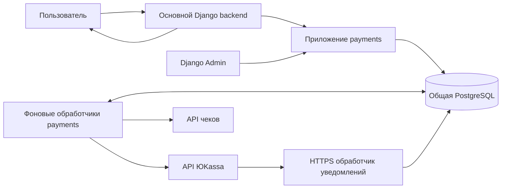
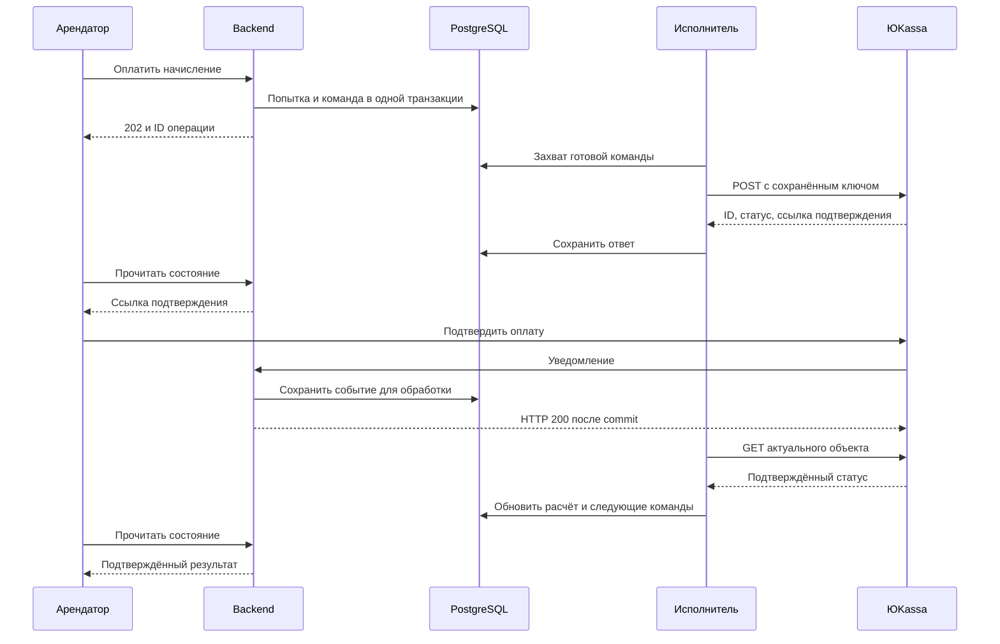

# Техническая архитектура платежей и залога

Дата: 7 ноября 2026 года. Статус: предложение реализации для обсуждения с командой. Прикладного кода в репозитории пока нет; описанные таблицы, процессы и интерфейсы предстоит реализовать. Бизнес-основа — [глоссарий](../GLOSSARY.md) и [ADR-0001](../docs/adr/0001-mvp-payment-scope.md), [ADR-0002](../docs/adr/0002-payment-and-payout-timing.md), [ADR-0003](../docs/adr/0003-cancellation-and-refunds.md), [ADR-0004](../docs/adr/0004-rental-and-payment-ownership.md). Их статус `proposed` сохраняется. Состояния GitHub Issues в этой сессии проверить не удалось: API GitHub недоступен; ссылки на задачи взяты из [сохранённого контекста](../SESSION_HANDOFF.md).

Предлагается подключаемое Django-приложение `payments`, общая PostgreSQL и фоновые обработчики из той же сборки. Все денежные операции сначала записываются в БД, затем исполняются через API провайдера. Результат подтверждается ответом API, проверенным уведомлением или последующей сверкой. Ожидание действий арендатора и банка не удерживает HTTP-запрос или транзакцию БД.

ЮKassa «Безопасная сделка» остаётся кандидатом. Внутренний учёт отдельного залога проектируется уже сейчас, но исполнение залога через этот продукт зависит от подтверждения провайдера. Особенно проблемен сценарий выплаты владельцу всей суммы залога при оплате комиссий площадкой. Проверенные API-факты и примеры вынесены в [исследование API](payments-api-research-2026-11-07.md).

## Ответы на исходные вопросы

| Вопрос | Предлагаемое решение |
|---|---|
| Много пользователей — блокируется поток? | Веб-запрос выполняет короткую транзакцию и заканчивается. Синхронный HTTP-вызов ЮKassa занимает один фоновый исполнитель, поэтому их число ограничивается и масштабируется отдельно. На ожидание оплаты пользователем исполнитель не выделяется. |
| Сколько ждать? | Разделяем приём команды, получение ссылки, подтверждение оплаты и поступление выплаты. Для нашего API задаём измеримые цели ниже; время банковской операции не обещаем как фиксированное. |
| Где храним идентификаторы? | В PostgreSQL: внутренние UUID, `payment_id`, `deal_id`, `refund_id`, `payout_id`, ключи повторов, сроки, суммы и связи с арендой. Память процесса и браузер не являются источником истины. |
| Как обходим платежи? | Уведомление находит объект по индексу внешнего ID. Фоновая сверка выбирает только операции с наступившим `next_check_at` и незавершённые сделки; всю историю регулярно не перебираем. |
| Что возвращает API? | JSON-объект с ID и статусом, суммой и дополнительными полями; при необходимости — ссылкой подтверждения. Успешный HTTP-ответ не обязательно означает успешное списание. |
| Что такое залог в модуле? | Отдельное реально списанное обязательство, отдельные попытки оплаты и отдельное решение о распределении. Выплата аренды не закрывает залог. |

## Границы ответственности и процессы

Основной backend владеет бронированием, участниками, согласованными условиями, разрешением передачи, выдачей и возвратом вещи. `payments` хранит неизменяемый снимок расчётных условий, считает доли, управляет денежными операциями и предоставляет подтверждённое финансовое состояние. Суммы из браузера не принимаются как основание списания.

В эксплуатации нужны:

1. **Общий веб-сервер Django.** Обслуживает пользовательские команды, чтение состояний, Admin и входящие уведомления.
2. **Фоновые обработчики.** Выполняют сохранённые команды, проверяют неопределённые результаты и обрабатывают уведомления. Работают отдельными процессами под supervision, перезапускаются после сбоя.
3. **Периодический запуск обслуживания.** Назначает сверку, проверяет сроки сделок и просроченные задания. Может быть management command по расписанию; он не выполняет долгие банковские вызовы сам.
4. **PostgreSQL.** Хранит условия, операции, входящие события, задания и аудит; резервные копии и восстановление обязательны.

Минимальный вариант без уже принятой командой очереди — задания в PostgreSQL и Django management command для их исполнения. Запись задания вместе с бизнес-изменением обеспечивает сохранение намерения отправить запрос. Если в основном проекте уже есть Celery и брокер, используем их: задание в БД остаётся основанием для восстановления после потери доставки. Добавлять Redis, Kafka или отдельный платёжный микросервис только ради этого модуля не требуется. PostgreSQL и исполнитель — техническое предложение к [контракту команды #3](https://github.com/Bunsans/p2p_sharing/issues/3), а не уже утверждённый стек.

Предлагаемая структура приложения: `models.py` и миграции для хранения, `services.py` для команд и расчётов, `provider.py` для конкретного клиента ЮKassa, `webhooks.py` и `urls.py` для входящих событий, `admin.py`, команды фонового исполнения и сверки, тесты денежных сценариев. Отдельную универсальную систему подключения произвольных провайдеров заранее не создаём.

## Нагрузка, блокировки и время ожидания

**Блокировка нужна для изменения денег одной аренды, а не для ожидания оплаты.** Например, две команды возврата должны последовательно проверить доступный остаток. На несколько SQL-запросов блокируем строку расчёта и связанные изменяемые строки, фиксируем решение и отпускаем блокировку. Другие аренды обрабатываются независимо; общие лимиты БД и провайдера всё равно ограничивают суммарную нагрузку.

Порядок выполнения любой исходящей операции:

1. В короткой `transaction.atomic()` проверяем права, версию условий и состояние. Создаём запись операции, резервируем сумму, сохраняем неизменяемое тело запроса и ключ идемпотентности. Фиксируем транзакцию.
2. Исполнитель забирает готовое задание с ограниченным сроком владения (`lease_until`). Блокировка строки нужна только для захвата задания. Для очереди используем `select_for_update(skip_locked=True)`, чтобы другие исполнители пропускали занятое задание. [Django: блокировки строк](https://docs.djangoproject.com/en/5.2/ref/models/querysets/#select-for-update), [PostgreSQL: SELECT](https://www.postgresql.org/docs/current/sql-select.html).
3. Вне транзакции вызываем API с тайм-аутом. Нельзя держать блокировку БД во время HTTP-запроса, пользовательского подтверждения или банковской обработки.
4. В новой короткой транзакции сохраняем ответ и применяем допустимый переход состояния. Проверяем версию/владение заданием; запоздалый ответ старого исполнителя не понижает уже подтверждённый статус.

Просроченный lease допускает восстановление исполнения **той же операции**, а не создание новой выплаты. Повторы защищены сохранённым ключом; после окончания гарантированного провайдером окна идемпотентности автоматический повтор создания запрещён. `on_commit()` можно использовать для ускоренного пробуждения исполнителя, но сам callback не заменяет сохранённое задание. [Django: действия после commit](https://docs.djangoproject.com/en/5.2/topics/db/transactions/#performing-actions-after-commit).

Стартовые настройки ниже — гипотезы для нагрузочного теста, не SLA ЮKassa и не результаты измерений:

| Этап | Проектная цель или настройка | Что видит пользователь |
|---|---|---|
| Приём команды нашим API | p95 до 500 мс при согласованной нагрузке | `202 Accepted`, ID операции и адрес чтения состояния |
| Получение задания исполнителем | p95 до 1 с вне перегрузки | «Готовим оплату» |
| Один вызов API провайдера | connect timeout 3 с, общий deadline 35 с; проверить ограничения выбранной HTTP-библиотеки | Ссылка появляется после сохранения ответа; при задержке — «Проверяем операцию» |
| Конфликт блокировки одной аренды | Стартовый предел ожидания 1 с; затем повтор с задержкой либо ответ о конфликте | Существующая операция или просьба обновить состояние, без нового списания |
| Проверка экрана оплаты | Раз в 2 с первые 30 с, затем раз в 5–10 с, только пока экран активен | Статус читается из нашей БД |
| Проверка неопределённой операции | Например, интервалы 5, 15, 30, 60 с с разбросом; далее реже и с учётом срока операции | Неопределённость не показывается как отказ |
| Подтверждение оплаты, зачисление выплаты или возврата | Зависит от метода, банка и состояния провайдера; фиксированное время не гарантируется | Отдельно «оплачено», «выплата обрабатывается», «возврат выполнен» |

ЮKassa документирует HTTP 500 при невозможности дать определённый ответ за 30 секунд. Это не доказательство отказа операции. Поэтому сетевой deadline ограничивает занятость исполнителя, но не определяет денежный результат. [Формат взаимодействия](https://yookassa.ru/developers/using-api/interaction-format).

Пример оценки, **не замер производительности**: при 20 одновременно исполняемых запросах и среднем внешнем ответе 0,5 с верхняя оценка — 40 вызовов/с до учёта накладных расходов и ограничений провайдера. Если ответы занимают 30 с, получится около 0,67 вызова/с. Десять новых аренд/с уже требуют минимум 40 вызовов создания при схеме «две сделки + два платежа», затем добавятся проверки и выплаты. Число пользователей онлайн само по себе не определяет нагрузку на ЮKassa.

Размер пула выбираем после измерений и подтверждения квот. При 429 и деградации API уменьшаем частоту, используем отложенный повтор, ограничиваем новые команды. Контролируем скорость по учётной записи провайдера, а не только число процессов. Проверки платежей на встрече и ближайших денежных сроков получают приоритет перед архивной сверкой; для приёма уведомлений сохраняем доступную ёмкость веб-сервера. Клиентский опрос не должен порождать GET к провайдеру. Поведение HTTP-ошибок сверяется с [документацией кодов ответа](https://yookassa.ru/developers/using-api/response-handling/http-codes).

## Что хранится в БД

Ниже логические сущности; окончательные имена моделей определяются при реализации. Деньги — целые копейки с валютой `RUB`, без `float`; API получает строку с двумя десятичными знаками. Временные отметки — UTC. Внешний ID хранится как непрозрачная строка и не заменяет внутренний UUID.

| Сущность | Основные данные | Зачем нужна отдельно |
|---|---|---|
| Расчёт аренды `Settlement` | `booking_id`, участники, версия условий, ставка, база владельца, наценка, залог, сроки, версия состояния | Снимок условий и точка сериализации конкурирующих денежных решений |
| Начисление `Charge` | Расчёт, назначение `rent/deposit/extra_time`, версия предложения, сумма, период, оплаченный остаток | Одна аренда имеет несколько оснований оплаты; повтор попытки не создаёт новое начисление |
| Сделка провайдера `ProviderDeal` | Внутренний ID, назначение, учётная запись, `deal_id`, статус, баланс из API, `expires_at` | Аренда, залог и доплаты не объединяются в одну сделку ЮKassa |
| Попытка оплаты `PaymentAttempt` | Начисление, сделка, `payment_id`, сумма, статус провайдера, ссылка подтверждения, `created_at`, `captured_at`, причина отмены | Отказ и повтор сохраняются как история; неизвестный результат не теряется |
| Возврат `Refund` | Исходная оплата, решение, сумма, `refund_id`, статус, причина отказа | Частичные возвраты и их повторные попытки не перезаписывают платёж |
| Выплата `Payout` | Основание, сделка, получатель, сумма, `payout_id`, статус | Оплата аренды и выплата владельцу имеют независимые результаты |
| Команда API `ProviderCommand` | Тип, ссылка на операцию, ключ идемпотентности, зафиксированное тело/его hash, первая отправка, попытки, `next_attempt_at`, lease, результат | Долговечная очередь и восстановление после сбоя, в том числе до получения внешнего ID |
| Входящее событие `ProviderEvent` | Учётная запись, тип, внешний ID, разрешённые поля уведомления, время получения, результат обработки | Подтверждённое сохранение до HTTP 200, повторы и аудит |
| Денежное решение `FinancialDecision` | Основание, участники согласования/администратор, сумма, автор, время, версия; отдельные подтверждения ручного исполнения | Решение о возврате или компенсации не равнозначно переводу денег |
| Получатель `Recipient` | Владелец, токен провайдера, маска карты, готовность, версия реквизитов | Замена карты не изменяет уже отправленную выплату |
| Чек `Receipt` | Связь с комиссией/корректировкой, ID и статус у кассы, ключ повтора, ошибка | Принятый платёж не означает автоматически сформированный чек |

Минимальные ограничения:

- Уникальные `booking_id` для расчёта и `(settlement_id, purpose, business_version)` для начисления; новые доплаты имеют собственные версии.
- Уникальные внешние ID в пределах провайдера, среды, учётной записи и типа объекта; уникальные ключи бизнес-команд. Повтор ключа с другими параметрами возвращает конфликт.
- Не более одной открытой попытки по начислению и одного принятого успешного результата. Состояние `unknown` считается открытым. Если сверка всё же обнаружила лишнее списание, сохраняем отдельную запись аномалии и разбираем возврат, не скрываем деньги ошибкой уникальности.
- Возвраты и выплаты резервируют сумму при создании команды. Остатки и резервы считаются по исходному платежу/сделке и назначению: залог не финансирует расчёты аренды. Сумма уже выполненного и находящегося в работе не превышает доступный остаток; операции с неизвестным результатом продолжают занимать резерв. Проверка выполняется под общей блокировкой расчёта, одного `CHECK` на отдельной строке для суммирования недостаточно.
- Финансовую историю не удаляем каскадно вместе с объявлением или пользователем. Исправления оформляем связанными корректировками.

Индексы нужны на `booking_id`, внешние ID, `(status, next_attempt_at)`, `(status, next_check_at)`, сроки открытых сделок и необработанные события. Фоновые выборки идут ограниченными пакетами, например по 100 записей с сортировкой по сроку и ID. Подтверждённо завершённые объекты исключаются из частого опроса; ещё открытая сделка проверяется даже после успешного платежа.

В БД находятся **учёт и доказательства операций**, а не сами деньги. Банковские средства находятся в контуре провайдера по договору. Секретные ключи — в секретах окружения, карточные PAN/CVC не принимаются нашим backend. Токен выплаты защищаем правами доступа и шифрованием в принятой инфраструктуре; в логи не выводим ключи, токены и платёжные ссылки. В событиях сохраняем только необходимые поля, а не бессрочно весь ответ с персональными данными.

## Интерфейс с основным backend

Внутри общей сборки вызываются Python-функции; дополнительный сетевой API между модулями не нужен. Пользовательские URL остаются частью основного backend. Все команды получают аутентифицированного автора, `command_id` для повтора и ожидаемую версию; клиент не может произвольно выбрать владельца или сумму.

| Предлагаемая команда | Вход и результат |
|---|---|
| `prepare_settlement` | Доверенный снимок условий → расчёт и начисления; провайдера пока не вызываем |
| `start_payment` | Разрешённая передача, начисление → существующая попытка либо новая сохранённая команда |
| `get_payment_state` | ID аренды/операции → статусы аренды и залога, ссылка подтверждения, состояние выплаты, допустимые действия |
| `confirm_handover` | Взаимное подтверждение выдачи → атомарная фиксация выдачи в основном backend и задания выплаты |
| `cancel_before_handover` | Подтверждённая отмена передачи → запрет выдачи и намерение вернуть всё принятое, включая поздние списания |
| `prepare_extra_time` | Согласованное предложение и расчёт суммарного времени → доплата либо нулевой остаток |
| `settle_deposit` | Согласие сторон или решение поддержки, компенсация → план возврата/выплаты с отдельным результатом каждой операции |
| `record_manual_execution` | Уполномоченный сотрудник и подтверждение внешнего исполнения → отдельная запись факта без изменения статуса исходной выплаты |

Для экрана достаточно, например, `rent.status`, `deposit.status`, `payout.status`, `action_required`, `confirmation_url`, `state_version`, `updated_at`. Одно поле `paid=true` непригодно: возможны «аренда оплачена, залог ожидается» и «аренда оплачена, выплата отклонена».

**Гонка выдачи и отмены:** обе команды берут блокировки в одном порядке: бронирование → расчёт → операции. Основной backend проверяет взаимные подтверждения и право выдачи, `payments` — обе успешные оплаты и отсутствие решений возврата. Изменение аренды и создание задания выплаты происходят в одной транзакции общей БД. Отмена использует тот же путь сериализации. Побеждает один переход; второй получает конфликт. Внешний вызов делается после commit. Изменение статуса аренды в обход этого контракта недопустимо. Обработчики уведомлений, сверки и Admin, которым нужны те же строки, соблюдают тот же порядок блокировок.

Для уведомления основного backend о денежных результатах используем локальный сервисный вызов в согласованной транзакции. Если команда выберет отложенную обработку, сохраняем событие доставки в БД; один Django signal или callback без восстановления не считается гарантированной доставкой. Критические действия всегда повторно проверяют актуальную версию расчёта.

## Работа с API и отслеживание оплаты

Для выбранного кандидата нужен API **ЮKassa**, а не API личного кошелька ЮMoney. Базовый адрес — `https://api.yookassa.ru/v3/`; запросы и ответы — JSON. В Safe Deal используются `shopId` и секрет магазина, включая выплаты внутри сделки; `account_id` виджета получателя также соответствует магазину. Для обычных выплат с баланса шлюза используются отдельные `agentId` и секрет шлюза. Эти продукты и их балансы нельзя смешивать. Ключи доступны только серверу. [Пример Safe Deal](https://yookassa.ru/developers/solutions-for-platforms/safe-deal/quick-start/freelance), [формат и аутентификация API](https://yookassa.ru/developers/using-api/interaction-format).

| Операция | Метод | Что сохраняем / что означает результат |
|---|---|---|
| Открыть безопасную сделку | `POST /deals` | ID, статус и фактический срок сделки; это ещё не оплата |
| Создать оплату | `POST /payments` | `id`, `status`, `amount`, при redirect — `confirmation.confirmation_url`, связь `deal` |
| Сверить оплату | `GET /payments/{id}` | Актуальный объект для проверки уведомления или неопределённого состояния |
| Вернуть списанное | `POST /refunds` | Отдельный `refund.id` и статус; исходный платёж остаётся историей списания |
| Сверить возврат | `GET /refunds/{id}` | Подтверждение результата возврата |
| Выплатить владельцу | `POST /payouts` | Отдельные `payout.id`, статус и связь со сделкой |
| Сверить выплату / сделку | `GET /payouts/{id}`, `GET /deals/{id}` | Результат перевода, баланс и закрытие сделки |

Поля конкретных запросов и примеры приведены в [исследовании API](payments-api-research-2026-11-07.md); первоисточник — [справочник ЮKassa](https://yookassa.ru/developers/api). Для настоящего списания в выбранном одноэтапном сценарии передаётся `capture: true`; поля связывания с безопасной сделкой обязательны по её инструкции. Оплату залога нельзя незаметно заменить двухэтапным холдом.

У платежа возможны `pending`, `waiting_for_capture`, `succeeded`, `canceled`. `waiting_for_capture` ещё не подтверждает окончательное списание. Для выдачи вещи требуем `succeeded` обеих оплат с ожидаемыми суммой и валютой. `unknown` — наше состояние знания после сетевого сбоя, а не статус ЮKassa. Возврат и выплата имеют собственные статусы. [Процесс платежа](https://yookassa.ru/developers/payment-acceptance/getting-started/payment-process), [справочник](https://yookassa.ru/developers/api).

Обработчик уведомлений проверяет формат, размер, разрешённый тип события и источник по актуальному списку IP с учётом доверенных proxy. Сохраняет событие и задание проверки, после commit возвращает HTTP 200. При недоступной БД не подтверждает доставку. Исполнитель запрашивает объект API в правильной учётной записи и проверяет ID, связь с нашей операцией, сумму, валюту и тестовую/боевую среду. Только после этого меняет денежное состояние. Возврат пользователя на `return_url` — навигация, не подтверждение оплаты. [Уведомления ЮKassa](https://yookassa.ru/developers/using-api/webhooks).

Повтор события не повторяет денежное действие. Для дедупликации достаточно составного ключа «среда/учётная запись + тип события + ID объекта» и идемпотентного обработчика; выдуманный `event_id` не требуется. При опережающем уведомлении до сохранения ответа на POST событие остаётся необработанным и связывается после сверки; `metadata` помогает поиску, но не заменяет проверку. Запоздалое событие не откатывает `succeeded` в `pending`; конфликтующие данные переводятся на сверку.

Сверка нужна даже при работающих webhook: доставка может быть потеряна, а нужного события может не быть. Например, доступен `refund.succeeded`, но в опубликованном списке нет `refund.canceled`; поэтому отказ возврата выясняем запросом. ЮKassa повторяет неподтверждённые уведомления в течение 24 часов, а не бессрочно. [Доступные события и доставка](https://yookassa.ru/developers/using-api/webhooks).

## Повторы, ошибки и восстановление

`command_id` защищает бизнес-действие в нашей БД; `Idempotence-Key` защищает конкретный POST к провайдеру. Это разные ключи. Повтор HTTP-запроса использует неизменные тело и ключ. Новые реквизиты после окончательного отказа — новая попытка с новым ключом, связанная с прежним основанием. ЮKassa гарантирует идемпотентность только 24 часа после первого запроса. [Правила идемпотентности](https://yookassa.ru/developers/using-api/interaction-format).

| Сбой | Реакция |
|---|---|
| Процесс упал после записи команды, до запроса | Другой исполнитель берёт сохранённую команду |
| Провайдер принял запрос, ответ потерян | Сохраняем `unknown`; если ID известен — GET, иначе повторяем тот же POST в безопасном окне |
| HTTP 200 и `pending` | Ждём события/проверяем позже; не помечаем оплату успешной |
| Timeout / HTTP 500 | Исход неизвестен; запрещены новый ключ и новое списание «на всякий случай» |
| Ошибка валидации / авторизации | Не делаем бесконечные повторы; исправляем данные/конфигурацию, фиксируем причину |
| HTTP 429 | Отложенный повтор с соблюдением указаний ответа и ограничением скорости; не считаем его подтверждённым банковским отказом |
| ID отсутствует, окно идемпотентности истекло | Автоматический POST останавливается. Ищем операцию в доступных списках/реестрах по нашему идентификатору и времени, затем через кабинет/поддержку; без доказательства исхода новая операция запрещена |
| Старый исполнитель вернулся после истечения lease | Проверяем версию, не перезаписываем новый результат; полезный ответ сохраняем для сверки |
| Провайдер долго недоступен | Команды остаются в БД, интерфейс показывает задержку, новые выдачи без подтверждённых оплат запрещены |

Рекомендации провайдера для `pending` и HTTP 500 предусматривают GET либо повтор того же запроса с увеличивающимся интервалом. [Обработка ответов](https://yookassa.ru/developers/using-api/response-handling/recommendations). В нашей реализации срок автоматических повторов заканчивается с запасом до 24 часов от первой потенциальной отправки: рестарт приложения этот срок не сбрасывает.

После восстановления БД из резервной копии исходящие денежные команды не запускаются вслепую: сначала сверяем временной промежуток, который мог выпасть из копии. Иначе можно повторно исполнить уже выполненную выплату с утраченным ключом.

## Сценарии аренды и денежные правила

Рабочая модель из ADR: владельцу причитается 800 ₽, наценка площадки 20% к базе — 160 ₽, стоимость аренды — 960 ₽. Залог, например 3 000 ₽, оплачивается отдельно и не увеличивает комиссию площадки. Комиссии провайдера — отдельный расход площадки; конкретные тарифы в расчёт пока не подставляются.

| Сценарий | Поведение модуля |
|---|---|
| Одобрена бронь | Проверяем готовность владельца к выплатам, фиксируем условия; денег ещё не списываем |
| Встреча после осмотра | По разрешению основного backend запускаем аренду и залог. Для простого UX можно показывать две оплаты последовательно; отдельность транзакций сохраняется |
| Обе оплаты успешны | Разрешаем подтверждение выдачи при действующем разрешении передачи; автоматически выданной вещь не считаем |
| Успешна только одна оплата | Повтор только подтверждённо неуспешной части либо отмена передачи с возвратом принятого |
| Одна оплата неизвестна | Сначала сверка. Выдача и новая попытка этой оплаты недоступны |
| Передача отменена | Фиксируем намерение полного возврата. Возвращаем все успешные оплаты, отслеживаем ещё незавершённые; поздний успех тоже порождает возврат |
| Выдача взаимно подтверждена | Сохраняем задание выплаты 800 ₽. Вещь уже выдана, результат выплаты отслеживается отдельно |
| Выплата отклонена | Уведомляем владельца и администратора, исправляем причину. После окончательного отказа разрешаем новую попытку; автоматического возврата арендатору нет |
| Возврат вещи без ущерба | Возвращаем весь залог, независимо от долга за время |
| Есть согласованная компенсация | Фиксируем согласованную сумму и распределяем залог по подтверждённой провайдером схеме |
| Есть спор | Залог ожидает решения поддержки в пределах срока провайдера; молчание не выбирает получателя |
| Требуется возврат уже выплаченной аренды | Решение администратора и отдельное ручное исполнение заказчика из резерва. Исходная выплата не меняется на «отменена» |

Платёжный модуль не вводит отдельный 30-минутный срок оплаты на встрече. Отмену передачи определяет основной backend. Истечение одного платежа не отменяет аренду; позднее уведомление при продолжающейся аренде не является причиной возврата.

Копеечное округление ещё надо согласовать в #3. Предлагается считать наценку с `Decimal`, округлять до копейки один раз по утверждённому правилу и фиксировать результат. Пропорциональный частичный возврат считать от исходного распределения накопительным итогом, вычитая уже возвращённые доли; последнему возврату отдавать остаток, чтобы несколько частичных возвратов точно сходились. Например, 480 ₽ из 960 ₽ соответствуют 400 ₽ владельца и 80 ₽ площадки, а не распределению 80/20 от общей суммы.

## Залог и ограничения выбранного продукта

Залог связан с той же арендой, но имеет независимые платёж и состояние распределения: ожидает оплаты → принят → ожидает возврата вещи/решения → исполняется распределение → завершён. Состояние «спор» описывает основание задержки, а не банковский статус. Необходимы дата предельного хранения и отдельные статусы возврата и компенсации.

Для залога 3 000 ₽ бизнес-итоги:

| Решение | Владельцу | Арендатору | Комиссии провайдера |
|---|---:|---:|---|
| Претензий нет | 0 ₽ | 3 000 ₽ | За счёт площадки |
| Подтверждено 500 ₽ ущерба | 500 ₽ | 2 500 ₽ | За счёт площадки |
| Подтверждено 3 000 ₽ ущерба | 3 000 ₽ | 0 ₽ | За счёт площадки |

Это требуемые результаты, **не доказанные возможности Safe Deal**. Документация допускает в одной сделке только один платёж в `pending`, `waiting_for_capture` или `succeeded`, а также требует разницу между оплатой и выплатой больше комиссии эквайринга. Поэтому гипотеза — отдельная сделка аренды, отдельная сделка залога и отдельные сделки доплат. Но разделение сделок само по себе не решает вопрос нулевой наценки и полного перечисления залога. [Приём оплаты Safe Deal](https://yookassa.ru/developers/solutions-for-platforms/safe-deal/integration/payments).

Инструкция возвратов разрешает возврат до выплаты и закрытия сделки; инструкция выплат связывает успешную выплату с закрытием сделки. Поэтому порядок «сначала выплатим компенсацию, потом вернём остаток из той же сделки» нельзя закладывать в реализацию. [Возвраты](https://yookassa.ru/developers/solutions-for-platforms/safe-deal/integration/refunds), [выплаты](https://yookassa.ru/developers/solutions-for-platforms/safe-deal/integration/payouts).

Кандидат последовательности для частичной компенсации, **только после подтверждения провайдером**:

1. Зафиксировать одно решение о распределении и зарезервировать обе суммы.
2. Вернуть арендатору остаток и дождаться подтверждённого возврата.
3. Проверить оставшийся баланс и срок сделки; перечислить компенсацию владельцу и дождаться результата.
4. Закрыть локальный расчёт только после подтверждения всех частей.

Даже этот порядок не устраняет комиссионное ограничение: после возврата 2 500 ₽ оставшихся 500 ₽ может быть недостаточно для выплаты 500 ₽ по стандартной схеме. Нужен явно разрешённый провайдером источник комиссий/дополнительного финансирования либо другой продукт. При сбое второй части первая не откатывается; расчёт остаётся частично исполненным с обязательством перед владельцем. Отдельно проверяются полный возврат без выплаты, полная компенсация и повтор выплаты с другой картой.

Опубликованный минимум частичного возврата — 1 ₽, оставшаяся сумма должна быть нулевой либо не менее 1 ₽; выплата на карту в Safe Deal также начинается от 1 ₽. Поэтому итог с компенсацией или возвращаемым остатком 0,50 ₽ нельзя просто отправить в API или молча округлить. Нужен согласованный порядок исполнения малых сумм. [Ограничения возвратов](https://yookassa.ru/developers/payment-acceptance/after-the-payment/refunds), [лимиты выплат](https://yookassa.ru/developers/solutions-for-platforms/safe-deal/integration/payouts).

До подтверждения схема залога работает только как учёт и моделирование; включение реальных списаний такого залога закрыто условием подключения. Это не повод самовольно исключить залог из MVP или заменить его холдом. Если кандидат не подходит, сохраняем бизнес-интерфейс и выбираем согласованную схему исполнения, пересматривая провайдерские части.

При споре учитываем фактический срок сделки из API и условия подключения. Плановый возврат должен уложиться в 14 суток от первой оплаты и оставить минимум 7 суток до предельного срока залога. Предупреждения — за 72 и 24 часа до предела. При вынужденном возврате залога провайдером фиксируем состоявшийся возврат, но спор продолжаем; позднюю компенсацию исполняет площадка из своего резерва отдельной операцией. Правило автоматического освобождения залога по молчанию не вводим. Источник бизнес-правил — [ADR-0002](../docs/adr/0002-payment-and-payout-timing.md) и [ADR-0003](../docs/adr/0003-cancellation-and-refunds.md).

## Продления, просрочка и ручные корректировки

Основной backend передаёт согласованное предложение продления с версией и сроком. Модуль суммарно рассчитывает дополнительное время по продлениям и просрочке, округляет вверх до получасового интервала и вычитает уже оплаченную доплату. Положительная доплата получает отдельное начисление, попытку и, для рассматриваемой схемы, отдельную сделку. Выплата за доплату не должна повторять выплату первоначальной аренды.

Если 10 минут уже оплачены как получасовой интервал, следующие 10 минут могут не требовать денег. Нулевой остаток не создаёт банковский платёж: основной backend применяет согласованное продление с подтверждением уже оплаченного покрытия. При положительном остатке продление действует только после согласия владельца и успешной оплаты актуального предложения.

Поздний успех оплаты устаревшего предложения сохраняем, но срок аренды автоматически не меняем. Предложение для #3 — возврат неиспользованной доплаты до выплаты владельцу; зачёт в новое предложение возможен только по явно согласованному правилу. Пока политика не утверждена, результат отправляется на разбор, повторная доплата с тем же покрытием не создаётся.

Начисление времени останавливается по подтверждённому фактическому возврату, а при утрате — по дате, установленной поддержкой. Долг за время хранится отдельно и не погашается залогом автоматически. Основной backend блокирует должнику новые аренды как арендатору, оставляя доступными оплату и оспаривание долга. Досрочный добровольный возврат не запускает автоматический перерасчёт уже оплаченного срока.

Поддержка подключается сразу при претензии либо через 24 часа без подтверждений возврата; целевой срок решения — 48 часов. Точные точки отсчёта ещё согласуются в #3. Их истечение эскалирует разбор, но не создаёт денежного решения. Если вещь найдена после компенсации, решение пересматривается с учётом фактических переводов; дальнейшие корректировки заказчик выполняет вручную через согласованный канал.

## Внешние зависимости и условия реализации

| Зависимость | Что требуется | Что блокирует |
|---|---|---|
| Основная команда | Подтвердить Django/PostgreSQL, общий transaction boundary выдачи/отмены, форматы сумм/версий и фонового исполнения | Подключение приложения к основному backend; [#3](https://github.com/Bunsans/p2p_sharing/issues/3) |
| Подключение Safe Deal | Договор площадки, доступ продукта для обычных физлиц, специальная тестовая интернет-площадка и ключи магазина; отдельный шлюз нужен при выборе обычных выплат | Реальные запросы нужного продукта; [#2](https://github.com/Bunsans/p2p_sharing/issues/2) |
| Залог | Подтверждение назначения платежа, полного возврата и полной/частичной компенсации без уменьшения причитающихся пользователям сумм | Боевой залог; #2 |
| Жизненный цикл | Подтверждённые сроки, закрытие сделки, судьба остатка и повтор выплаты после отказа | Безопасное завершение и продление аренды; #2 |
| Ограничения API | Квоты по методам/учётным записям, лимиты сумм, доступные способы оплаты, тарифы и поведение при деградации | Параметры пула, частота сверки, финансовый расчёт расходов; #2 |
| Получатели | Виджет токенизации и необходимые проверки владельца | Готовность к выплатам до первой одобренной заявки |
| Публичный HTTPS endpoint | TLS, настройка событий, проверка источника, стабильный адрес | Доставка уведомлений; сверка остаётся обязательной |
| Касса и документы | Канал отправки чеков, данные покупателя, налоговые настройки и отдельный порядок документов по залогу | Реальный запуск; [#4](https://github.com/Bunsans/p2p_sharing/issues/4) |
| Средства площадки | Баланс для комиссий, резерв для возвратов после выплат и поздней компенсации, канал ручного исполнения | Выполнение финансовых обязательств; #4 |

Интеграция чеков на комиссию площадки и её возврат входит в модуль. Событие для чека и его сумма определяются подтверждённой моделью заказчика; отправка имеет отдельный статус и безопасные повторы. Ошибка кассы не превращает состоявшуюся оплату в неуспешную. Инструкция Safe Deal по чекам не устанавливает автоматически порядок документов для залога. [Чеки в Safe Deal](https://yookassa.ru/developers/solutions-for-platforms/safe-deal/integration/receipts).

Тестовый обычный магазин не заменяет проверку именно Safe Deal и выплат. Подключение его тестовой площадки описано отдельно. [Тестирование Safe Deal](https://yookassa.ru/developers/solutions-for-platforms/safe-deal/testing).

## Проверки реализации и наблюдаемость

Для будущей реализации нужны сценарные проверки денежных инвариантов, а не только успешный HTTP-запрос:

| Проверка | Критерий |
|---|---|
| Два одновременных нажатия «оплатить» | Одна открытая попытка и одна операция у провайдера; повторные HTTP-запросы используют тот же ключ |
| Ответ потерян после принятого POST | После восстановления нет второго списания/выплаты |
| Одинаковое уведомление несколько раз | Один переход состояния, одно последующее денежное действие, один чек |
| Уведомление раньше ответа или в обратном порядке | Корректная связь и отсутствие отката финального статуса |
| Одновременно выдача и отмена | Ровно один допустимый исход; нет выплаты за выдачу вместе с полным возвратом за непередачу |
| Только аренда или только залог оплачены | Выдача запрещена; повторяется нужная часть либо возвращается принятое |
| Успех после отмены передачи | Поздняя оплата возвращается один раз |
| Два частичных возврата одновременно | Сумма исполненного и зарезервированного не превышает разрешённый остаток |
| Возврат залога успешен, компенсация отклонена | Сохранены обе части результата и оставшееся обязательство |
| Неизвестный POST старше окна идемпотентности | Автоматического нового POST нет; есть видимая задача сверки |
| Долг за время и вещь без ущерба | Возвращается весь залог, долг сохраняется отдельно |
| Продление с нулевой доплатой / устаревшая версия | Нет нулевого платежа, двойного округления и самовольного изменения срока |
| Срок провайдера истёк во время спора | Реальные движения отражены; спор и обязательство площадки не исчезают |
| Нагрузка и медленный провайдер | Наш API и webhook остаются доступны, размер очереди и время её ожидания видимы |

Конкурентные проверки выполняются на PostgreSQL с независимыми соединениями: SQLite не проверяет выбранное поведение блокировок. Django рекомендует `TransactionTestCase` для проверки `select_for_update()`. [Документация Django](https://docs.djangoproject.com/en/5.2/ref/models/querysets/#select-for-update).

В Admin нужны список аренды и связанных операций, суммы и остатки, сроки, неопределённые результаты, очередь возвратов/выплат, решения и подтверждения ручного исполнения. Доступны только разрешённые действия; статусы провайдера вручную не редактируются. Все денежные действия проверяют роль, основание, сумму и версию, защищаются от повтора и фиксируют автора.

Метрики: время ответа нашего API и провайдера, очередь и возраст старейшей команды, ошибки/429, задержка обработки webhook, количество и возраст `unknown`, ожидание блокировок, отказы выплат и чеков, незавершённые сделки около срока, расхождения с реестрами. Логи связываются через `booking_id`, ID операции и внешний ID без секретов. Ежедневная сверка доступных реестров нужна для обнаружения пропущенных операций и проверки финансового итога; она дополняет оперативные проверки.

## Порядок реализации

1. Согласовать контракт #3; параллельно подтвердить API-продукт и залог в #2, резерв и документы в #4. Рабочую бизнес-модель повторно не пересматривать без новых фактов.
2. Реализовать независимое ядро из [#5](https://github.com/Bunsans/p2p_sharing/issues/5): снимки условий, начисления, суммы, команды, историю, блокировки и восстановление. Проверить на имитации провайдера с явным обозначением этого режима.
3. Пройти [#6](https://github.com/Bunsans/p2p_sharing/issues/6): реквизиты владельца → две оплаты → выдача → выплата, с настоящими ID и уведомлениями тестового продукта.
4. Добавить частичный успех и возвраты [#7](https://github.com/Bunsans/p2p_sharing/issues/7), подтверждённую схему залога и ручные корректировки [#8](https://github.com/Bunsans/p2p_sharing/issues/8), продления и долг [#9](https://github.com/Bunsans/p2p_sharing/issues/9). Чеки реализовать вместе с соответствующими денежными сценариями.
5. Выполнить сквозную и нагрузочную приёмку [#10](https://github.com/Bunsans/p2p_sharing/issues/10), проверить восстановление и финансовую сверку. Реальные платежи включать после подтверждения внешних условий.

Эта записка дополняет исследование и локальные ADR; каноническая спецификация и задачи остаются в GitHub Issues. Она не меняет их статусы и не подтверждает подключение продукта. Код, нагрузочные измерения, операции в песочнице и договорные условия в рамках подготовки записки не проверялись.
